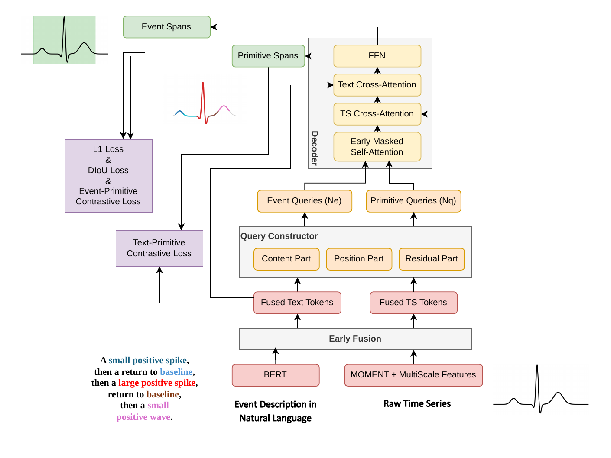

<div align="center">

# ⏱️ GroundingMOMENT

### Describe what matters. Find where it happens.


[Tianjun Hou](https://houtj.github.io/), [Xiqing Chang](https://www.linkedin.com/in/xiqing-c-69b937199/), [Chenwei Wan](https://www.linkedin.com/in/sky-chenwei-wan/)

[📄 Paper](https://aclanthology.org/2026.findings-emnlp.229/) ·
[🖼️ Poster](assets/poster/groundingmoment_emnlp2026_poster.pdf) ·
[🏗️ Architecture](#-model) ·
[🎬 Demos](#-demos) ·
[🤖 Data Generation](https://github.com/houtj/GroundTSSyn) ·
[✒️ BibTeX](#-citation) ·
[✉️ Contact](mailto:thou2@slb.com)

</div>

GroundingMOMENT is a zero-shot cross-modal framework for localizing events
described in natural language within a time series. It predicts the temporal
span of each event and the spans of its constituent structural atomic patterns.

## 🔥 News

- **November 2026:** GroundingMOMENT was published in **Findings of EMNLP 2026**.
- **November 2026:** We released a
  [paper-level architecture guide](grounding_moment_architecture.md) with
  explanatory pseudocode.
- **November 2026:** We are hiring Master’s/Ph.D.-level research interns on the topic of **language-guided time series analysis** for the year 2027. If you are interested, please feel free to contact me at thou2@slb.com with a CV and a short description of your research interests

## 🎬 Demo

The included short clips illustrate language-guided grounding on synthetic
signals, drilling-position telemetry, and electrocardiogram signals:

<table>
  <tr>
     <td width="50%" align="center">
      <video
        src="https://github.com/user-attachments/assets/7ebb30ba-065b-4906-bbb7-ba9900481c00"
        controls>
      </video>
      <br>
      <strong>Synthetic pattern</strong>
     </td>
    <td align="center" width="50%">
      <video
        src="https://github.com/user-attachments/assets/163ef731-96cc-494f-b77b-c5389806501c"
        controls>
      </video>
      <br>
      <strong>Drilling-cycle pattern</strong>
    </td>
  </tr>
  <tr>
    <td align="center" width="50%">
      <video
        src="https://github.com/user-attachments/assets/c0b37d13-d10c-4a3b-a46c-7ebef3bcc129"
        controls>
      </video>
      <br>
      <strong>ECG heartbeat query</strong>
    </td>
    <td align="center" width="50%">
      <video
        src="https://github.com/user-attachments/assets/21e77f4b-54c5-48e3-89b0-dc410f6fc923"
        controls>
      </video>
      <br>
      <strong>ECG heartbeat query (sliding window)</strong>
    </td>
  </tr>
</table>

## 💡 Highlights

Conventional time-series classifiers assign a label to a fixed window. They do
not necessarily identify the exact start and end of an event, and adapting them
to a new domain usually requires specialized labels and further training.

GroundingMOMENT instead conditions detection on a natural-language description.
Domain knowledge can be expressed directly in the query, while reusable
structural primitives provide a bridge between language and waveform
morphology. This enables:

- **Zero-shot domain transfer:** query new event types without domain-specific
  model fine-tuning.
- **Precise localization:** return event boundaries instead of only a
  window-level label.
- **Auditable evidence:** expose the lower-level primitives supporting each
  event detection.
- **Efficient inference:** avoid iterative tool calls and per-query token costs
  associated with agentic alternatives.

On GroundTSBench, the paper reports **79.2 event mAP**, **88.7 primitive mAP**,
and approximately **1.2 seconds per sample** in the reported evaluation setup.
See the paper for baselines, protocols, ablations, and limitations.

## 🦕 Model

<div align="center">
  <a href="assets/architecture/groundingmoment_architecture.pdf">
    
  </a>
</div>

GroundingMOMENT adapts the language-guided grounding pattern to one-dimensional
signals: a natural-language event description and a raw time series are fused
early, decoded through event and primitive queries, and returned as auditable
temporal spans.

### How it works

1. **Encode both modalities.** MOMENT represents a 512-step univariate time
   series as temporal patches, while BERT represents the natural-language
   event description.
2. **Build a temporal feature pyramid.** Strided one-dimensional convolutions
   produce seven temporal scales, allowing short and long patterns to be
   localized.
3. **Fuse early across modalities.** Six bidirectional feature-enhancer layers
   exchange information between time-series and text tokens.
4. **Initialize language-guided queries.** Primitive queries select temporal
   tokens aligned with individual text tokens; event queries select tokens
   aligned with an attention-pooled whole-description representation.
5. **Decode the hierarchy jointly.** Sixty-four primitive queries and sixteen
   event queries share a six-layer decoder. A compositional attention mask
   prevents primitive predictions from taking shortcuts through event context,
   then allows event queries to aggregate stable primitive evidence.
6. **Predict spans and correspondence.** Separate heads localize primitive and
   event spans and associate detected primitives with their parent events.

The [full architecture figure](assets/architecture/groundingmoment_architecture.pdf)
and [architecture guide](grounding_moment_architecture.md) introduce each model
block, the published equations, and the end-to-end tensor flow.

## 📦 Scope of this release

Due to company policy, this repository is only a **research communication release**, not the complete
implementation or a reproducibility package.

We welcome scientific collaborations. To access the **source code**, **checkpoint** and **data-generation pipeline**, contact
[thou2@slb.com](mailto:thou2@slb.com) with your affiliation, research
objective, requested materials, and expected timeline.

## 🏷️ Research roadmap

Planned directions include:

- extending GroundingMOMENT from univariate to multi-channel inputs;
- supporting broader and more varied natural-language descriptions;
- developing joint time-series and language **reasoning models** for the petroleum
  domain.

## Acknowledgement
Our model is built based on [BERT](https://github.com/google-research/BERT) and [Moment](https://github.com/moment-timeseries-foundation-model/moment). The architecture is inspired by [GroundingDINO](https://github.com/IDEA-Research/GroundingDINO). Thanks for their great work.

## ✒️ Citation

If this work supports your research, please cite:

```bibtex
@inproceedings{hou-etal-2026-language,
  title     = {Language-Guided Time-Series Event Detection with Zero-Shot Cross-Modal Grounding},
  author    = {Hou, Tianjun and Chang, Xiqing and Wan, Sky Chenwei},
  editor    = {Lee, Hung-Yi and Dev, Sunipa and Li, Jessy and Elliott, Desmond},
  booktitle = {Findings of the Association for Computational Linguistics: EMNLP 2026},
  month     = oct,
  year      = {2026},
  address   = {Budapest, Hungary},
  publisher = {Association for Computational Linguistics},
  pages     = {4813--4836},
  doi       = {10.18653/2026.findings-emnlp.229},
  url       = {https://aclanthology.org/2026.findings-emnlp.229/}
}
```

Machine-readable metadata is available in [`CITATION.cff`](CITATION.cff).

## ⚖️ Rights and use

Copyright 2026 SLB. All rights reserved. No open-source license is granted for
this repository. Review [`NOTICE.md`](NOTICE.md) before using or redistributing
any material.
