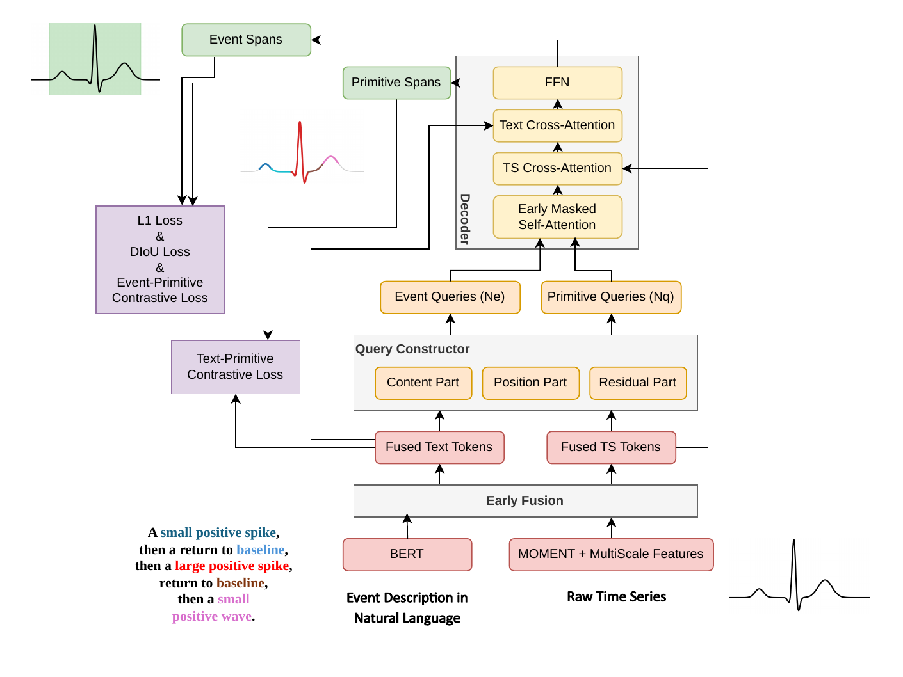

# GroundingMOMENT architecture guide

This document introduces the main blocks of GroundingMOMENT and shows how data
flows between them. The snippets are paper-level pseudocode: they clarify tensor
shapes, query construction, and attention structure, but are **not** a complete
training or inference implementation.

GroundingMOMENT is described in:

> Tianjun Hou, Xiqing Chang, and Sky Chenwei Wan.  
> [Language-Guided Time-Series Event Detection with Zero-Shot Cross-Modal
> Grounding](https://aclanthology.org/2026.findings-emnlp.229/).  
> Findings of EMNLP 2026.

<div align="center">
  <a href="assets/architecture/groundingmoment_architecture.pdf">
    
  </a>
</div>

## 1. Architecture at a glance

The model receives two inputs:

- a univariate time series of 512 steps; and
- a natural-language description of the event to locate.

The processing path has six main blocks:

1. **Time-series encoder:** MOMENT converts the signal into patch tokens.
2. **Temporal feature pyramid:** strided Conv1D layers create multiple temporal
   resolutions.
3. **Language encoder:** BERT converts the event description into text tokens.
4. **Early fusion:** bidirectional attention exchanges information between the
   two modalities.
5. **Language-guided query constructor:** fused temporal tokens are selected as
   primitive and event query anchors.
6. **Hierarchical decoder and prediction heads:** the model jointly predicts
   primitive spans, event spans, and their correspondence.

In compact form:

```text
raw time series ──► MOMENT ──► temporal pyramid ──┐
                                                  ├─► early fusion
event description ───────────► BERT ─────────────┘
                                                        │
                                                        ▼
                                              fused TS/text tokens
                                                        │
                                                        ▼
                                      language-guided query constructor
                                         │                         │
                                         ▼                         ▼
                                  primitive queries          event queries
                                         └──────────┬──────────────┘
                                                    ▼
                                      hierarchical span decoder
                                                    │
                            ┌───────────────────────┼──────────────────────┐
                            ▼                       ▼                      ▼
                     primitive spans          event spans       correspondence
```

## 2. Shared dimensions and model scale

The published configuration uses a shared hidden dimension so that temporal and
text tokens can interact through dot-product attention.

```python
from dataclasses import dataclass


@dataclass(frozen=True)
class PaperConfig:
    input_length: int = 512
    patch_size: int = 8
    hidden_dim: int = 256
    feature_levels: int = 7
    attention_heads: int = 8
    enhancer_layers: int = 6
    decoder_layers: int = 6
    primitive_queries: int = 64
    event_queries: int = 16
    event_isolation_warmup_epochs: int = 8
```

We use the following notation throughout this guide:

- `B`: batch size
- `T`: number of text tokens
- `N`: total number of multi-scale time-series tokens
- `D`: shared hidden dimension
- `Nq`: number of primitive queries
- `Ne`: number of event queries

## 3. Time-series encoder and temporal feature pyramid

### MOMENT patch encoder

MOMENT divides each 512-step input into patches and maps them to temporal
features. With a patch size of 8, the first representation contains 64 temporal
tokens.

```python
# x: (B, 512, 1)
patch_tokens = moment_encoder(x)
# patch_tokens: (B, 64, D)
```

### Multi-scale temporal features

Events may last for a few samples or cover a large part of the input window.
A seven-level feature pyramid therefore applies strided one-dimensional
convolutions to create progressively coarser temporal representations.

```python
levels = [patch_tokens]

for downsample in temporal_downsampling_layers:
    levels.append(downsample(levels[-1]))

# Example token counts: 64, 32, 16, 8, 4, 2, 1
time_series_tokens = concatenate(levels, dim=1)
# time_series_tokens: (B, N, D)
```

Fine levels preserve precise boundaries, while coarse levels provide context
for long-duration events.

## 4. Language encoder

BERT encodes the complete event description. Each valid text token remains
available for primitive-level matching, rather than reducing the sentence to a
single vector immediately.

```python
# input_ids: (B, T)
# attention_mask: (B, T)
text_tokens = bert(input_ids, attention_mask)
text_tokens = text_projection(text_tokens)
# text_tokens: (B, T, D)
```

This token-level representation lets phrases such as “small positive spike” or
“return to baseline” guide different primitive queries.

## 5. Early bidirectional fusion

The feature enhancer aligns the modalities before query initialization. Each of
its six layers contains:

1. time-series self-attention;
2. text self-attention;
3. time-series-to-text cross-attention;
4. text-to-time-series cross-attention; and
5. modality-specific feed-forward updates.

After this stage:

- each temporal token contains information about the requested event; and
- each text token contains information about the observed waveform.

## 6. Language-guided query constructor

The decoder uses two query families with different responsibilities:

- **primitive queries** localize atomic waveform patterns associated with
  individual text tokens;
- **event queries** localize complete events described by the sentence.

### 6.1 Global event-description vector

An attention-pooling module condenses the fused text tokens into a single
description vector. Padding tokens receive no probability mass.

For fused text memory \(M_{\text{text}}\), this computes:

\[
\alpha_j = \operatorname{softmax}(\operatorname{MLP}(M_{\text{text},j})),
\qquad
d = \sum_j \alpha_j M_{\text{text},j}.
\]

### 6.2 Primitive and event anchor scores

Every fused temporal token receives two scores:

- its strongest similarity to any valid text token, used for primitive
  queries; and
- its similarity to the whole-description vector, used for event queries.


### 6.3 Anchor selection and query parts

The highest-scoring temporal locations initialize 64 primitive queries and 16
event queries. Each query combines content, positional, and residual parts.

This initialization makes the decoder queries language-conditioned before
iterative span refinement begins.

## 7. Hierarchical decoder

The six-layer decoder jointly updates both query families. A layer contains
masked query self-attention, text cross-attention, time-series cross-attention,
and a feed-forward network.

### Compositional attention mask

The query self-attention mask enforces the intended hierarchy:

- primitive queries never read from event queries;
- during warm-up, event queries are also isolated from primitive queries;
- after warm-up, event queries may aggregate stable primitive evidence.

The post-warm-up direction is therefore compositional: primitives remain
grounded in local text and signal evidence, while event queries can combine
those primitive detections into a complete event.

## 8. Prediction heads

The decoded representations feed separate heads:

```python
primitive_state = queries[:, :config.primitive_queries]
event_state = queries[:, config.primitive_queries:]

primitive_spans = primitive_span_head(primitive_state)
primitive_token_logits = primitive_text_head(primitive_state, text_memory)

event_spans = event_span_head(event_state)
event_primitive_logits = correspondence_head(
    event_state,
    primitive_state,
)
```

The output has four conceptual parts:

- primitive temporal spans;
- primitive-to-text correspondence scores;
- event temporal spans; and
- event-to-primitive correspondence scores.

Together they provide both the final event localization and the lower-level
evidence supporting it.

## 9. Training objective

The paper combines span localization, primitive classification, and
event–primitive correspondence losses:

\[
\mathcal{L}
= \lambda_1 \mathcal{L}_{\text{primitive span}}
+ \lambda_2 \mathcal{L}_{\text{primitive class}}
+ \lambda_3 \mathcal{L}_{\text{event span}}
+ \lambda_4(t) \mathcal{L}_{\text{event--primitive}}.
\]

Span supervision uses L1 and one-dimensional DIoU losses with Hungarian
matching. The time-dependent \(\lambda_4(t)\) follows the staged introduction
of event-to-primitive composition.

## Scope of this guide

This guide covers only architecture details disclosed in the paper. It does not
include backbone internals, complete feature-enhancer or decoder
implementations, data generation, training code, checkpoint loading, or
inference post-processing. See [`NOTICE.md`](NOTICE.md) for the release terms.
